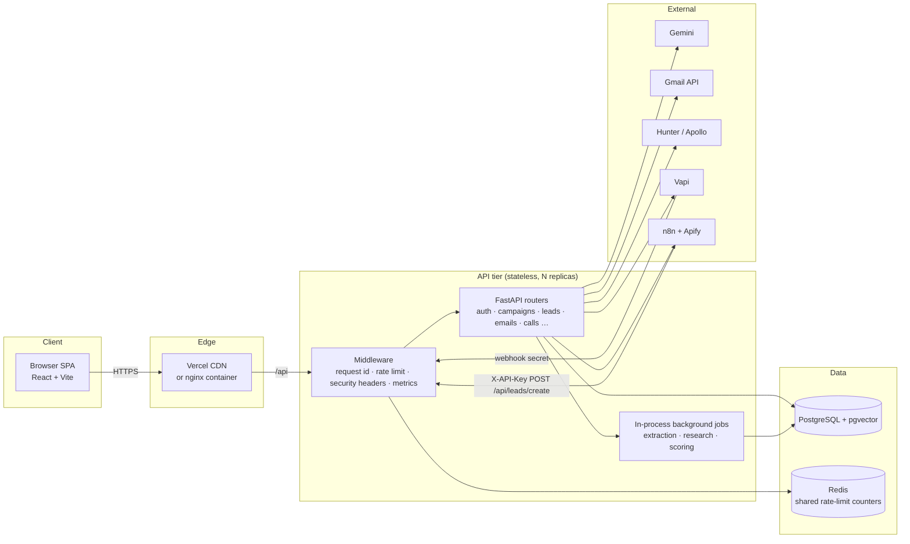
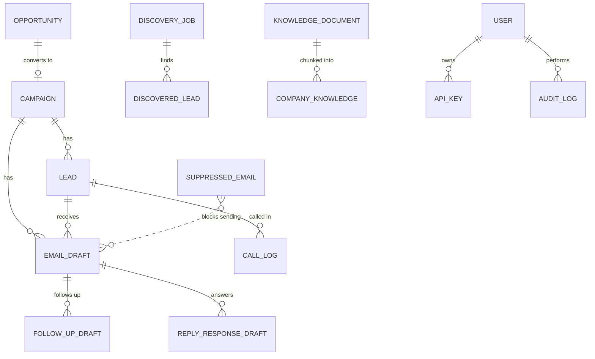

# Architecture & system design

This document describes how Lead Agent is built, how a request flows through it,
and how it is meant to scale and fail. For setup steps see [DEPLOYMENT.md](DEPLOYMENT.md).

## 1. Components

| Component | Responsibility | State |
|---|---|---|
| SPA (`frontend/`) | UI, routing, auth token storage, route-level code splitting | Browser only |
| nginx / Vercel | Static assets (immutable cache), SPA fallback, same-origin `/api` proxy, security headers | None |
| API (`backend/app`) | Business logic, auth, validation, outbound integrations | **Stateless** (any replica can serve any request) |
| PostgreSQL | System of record; `pgvector` for semantic knowledge search | Durable |
| Redis | Fixed-window rate-limit counters shared by all replicas | Ephemeral (safe to lose) |

## 2. Request lifecycle

1. **`RequestContextMiddleware`** (pure ASGI, so streaming and background tasks are
   never buffered): assigns/propagates `X-Request-ID`, applies the rate limit for the
   route's bucket, records Prometheus metrics, writes a structured access log line,
   and adds security headers.
2. **CORS / GZip / TrustedHost**.
3. **Router dependency `require_auth`**: accepts `Authorization: Bearer <JWT>` (people)
   or `X-API-Key` (automations). Webhook and OAuth-callback paths authenticate
   themselves (signed state, webhook secret, signed unsubscribe token).
4. Handler → SQLAlchemy session (`get_db`, one per request, pooled connections).
5. Errors are returned in one envelope: `{status, detail, code, request_id}`, so any
   user-visible error can be traced to a log line.

## 3. Security model

| Concern | Control |
|---|---|
| Authentication | PBKDF2-SHA256 passwords (390k iterations), HS256 JWT (12 h), hashed API keys (shown once) |
| Authorization | Roles `admin` / `member`. Admin-only: members, audit log, system status, removing unsubscribed recipients |
| Brute force | `auth` rate-limit bucket (10/min per client), constant-time login path for unknown emails |
| Secrets at rest | Gmail OAuth tokens encrypted with Fernet (`TOKEN_ENCRYPTION_KEY`, falls back to `SECRET_KEY`) |
| Outbound email | Only `approved` drafts; atomic `approved → sending` claim prevents double sends; header injection stripped; suppression list checked on every send; daily cap |
| Compliance | Signed one-click unsubscribe (RFC 8058 `List-Unsubscribe-Post`), GET never mutates state |
| SSRF | Scrapers resolve hosts and refuse non-public IPs, re-check every redirect |
| Uploads | Size and row limits, encoding checks, values clipped to column widths |
| CSV export | Spreadsheet formula injection neutralised |
| Audit | Append-only `audit_logs`: sign-ins (incl. failures), sends, deletes, member and key changes |
| Boot guard | Production refuses to start with a default `SECRET_KEY`, SQLite, or auth disabled |
| Supply chain | `scripts/security_scan.py` in CI, `npm ci --ignore-scripts` (see SECURITY.md incident) |

## 4. Data model (core)

Hot-path indexes (created by `app/db/migrations.py`): `leads(campaign_id, status)`,
`leads(email)`, `leads(website)`, `email_drafts(campaign_id, status)`,
`email_drafts(sent_at)`, status indexes on follow-up and reply drafts.

## 5. Background work

Email extraction, lead research and lead scoring run as FastAPI background tasks in
the API process that accepted the request. Each job is a row (`*_jobs` table) that the
UI polls, so progress survives page reloads and is visible from any replica.

Failure handling:

- On boot, `recover_stale_work` marks jobs older than `STALE_JOB_MINUTES` that are
  still `pending`/`running` as failed (the process that owned them is gone), and moves
  drafts stuck in `sending` to `failed` with a "check Gmail Sent before retrying"
  message, so nothing is sent twice blindly.
- Jobs process leads one at a time with small delays to respect Gemini/Hunter quotas.

**Scaling path:** when jobs need to outlive a request worker or run on a schedule, move
the job bodies (already isolated as `_run_*_job(job_id, …)` functions that open their
own session) onto a queue (RQ/Celery/Arq on the existing Redis). The job tables and
polling API stay the same.

## 6. Schema migrations

`python -m app.cli migrate` runs `create_all`, the additive `ensure_*_columns`
helpers, and index creation. It is idempotent and takes a PostgreSQL advisory lock, so
several replicas booting at once (or a pre-deploy step racing a boot) serialise safely.
CI runs it twice concurrently and once more to prove both properties.

## 7. Scaling

| Load | Change |
|---|---|
| 1 instance | SQLite is fine for local dev only; use PostgreSQL everywhere else |
| Several replicas | Set `REDIS_URL` so rate limits are global; workers via `WEB_CONCURRENCY` |
| DB connections | `DB_POOL_SIZE` × `DB_MAX_OVERFLOW` × replicas must stay under Postgres `max_connections`; add PgBouncer beyond ~4 replicas |
| Read-heavy lists | Lead search is server-side paginated (`/api/leads/search`); dashboard counts use grouped queries |
| Long AI batches | Move background jobs to a queue (section 5) |
| Static assets | Hashed filenames + `immutable` caching; `index.html` is `no-cache` |

## 8. Observability

- **Logs**: JSON in production (`LOG_JSON=true`), one access line per request with
  `request_id`, method, path, status and duration.
- **Metrics**: `GET /metrics` (Prometheus; protect with `METRICS_TOKEN`):
  request rate/latency by route, in-flight requests, rate-limit rejections, emails sent
  by result (`sent`, `error`, `suppressed`, `invalid_address`), background jobs.
- **Health**: `/api/health/live` (process up; for restarts), `/api/health/ready`
  (DB and Redis reachable; for load-balancer routing), `/api/health` (version, uptime).
- **Audit**: `/activity` page or `GET /api/audit/`.

## 9. Failure modes

| Failure | Behaviour |
|---|---|
| Redis down | Rate limiter fails open and logs a warning; readiness reports `redis: error` |
| Postgres down | Readiness returns 503 so traffic drains; liveness stays up (no restart loop) |
| Gemini/Hunter/Vapi errors | Per-lead errors are stored on the lead/job; the batch continues |
| Gmail send error | Draft becomes `failed` with the API error; metrics count `error` |
| Process killed mid-job | Recovered on next boot (section 5) |
| New frontend deployed while tab open | Error boundary detects stale chunk and offers reload |
